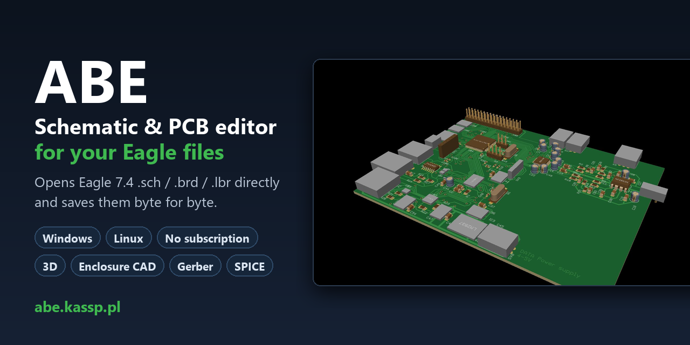
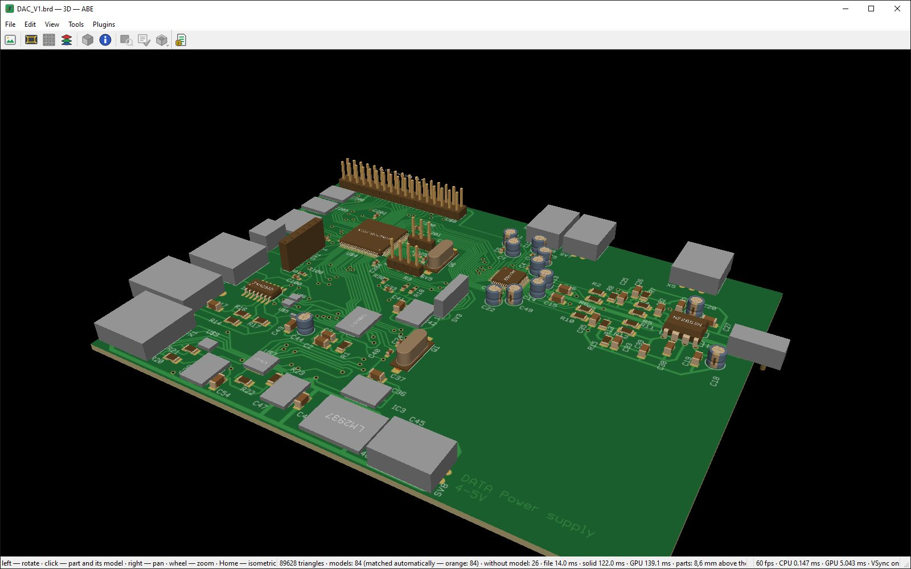
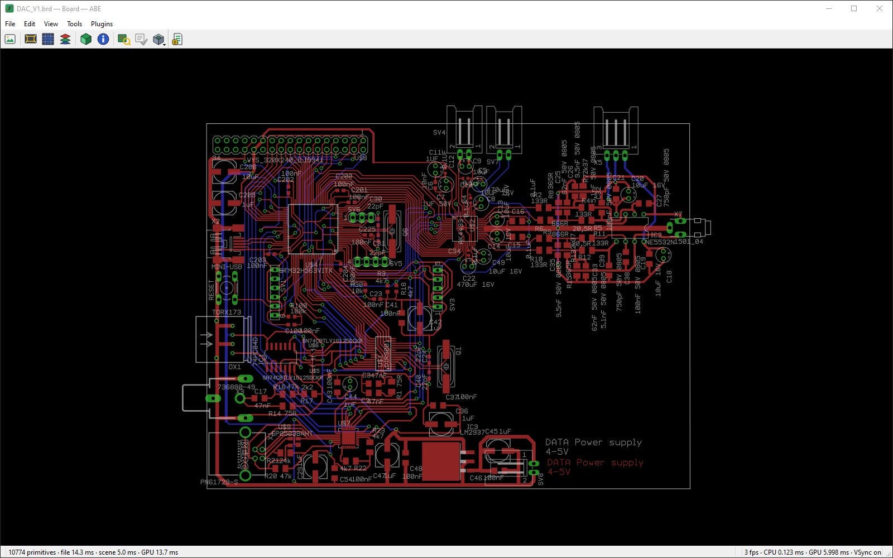
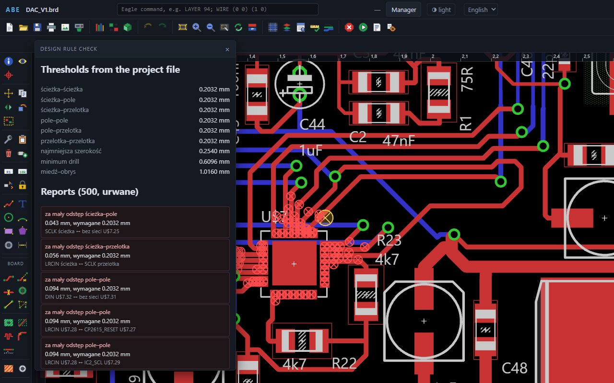
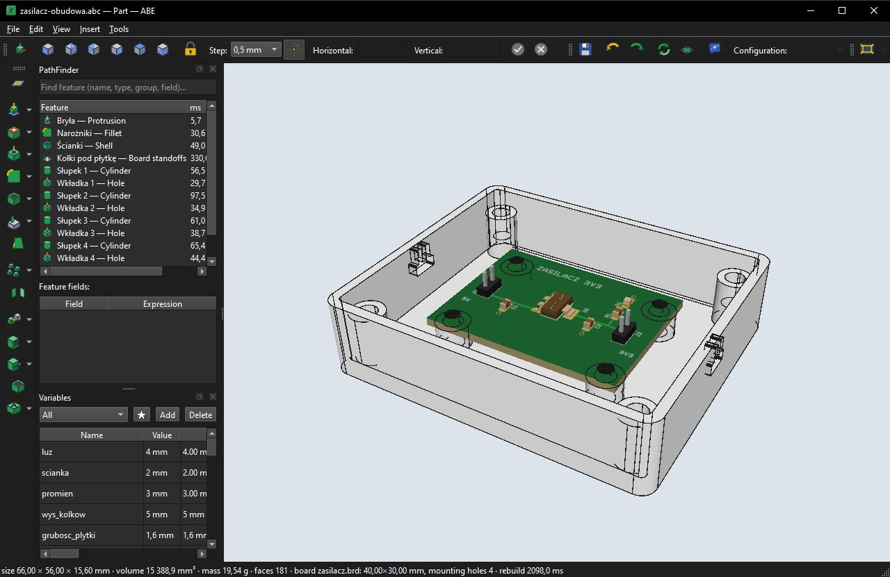
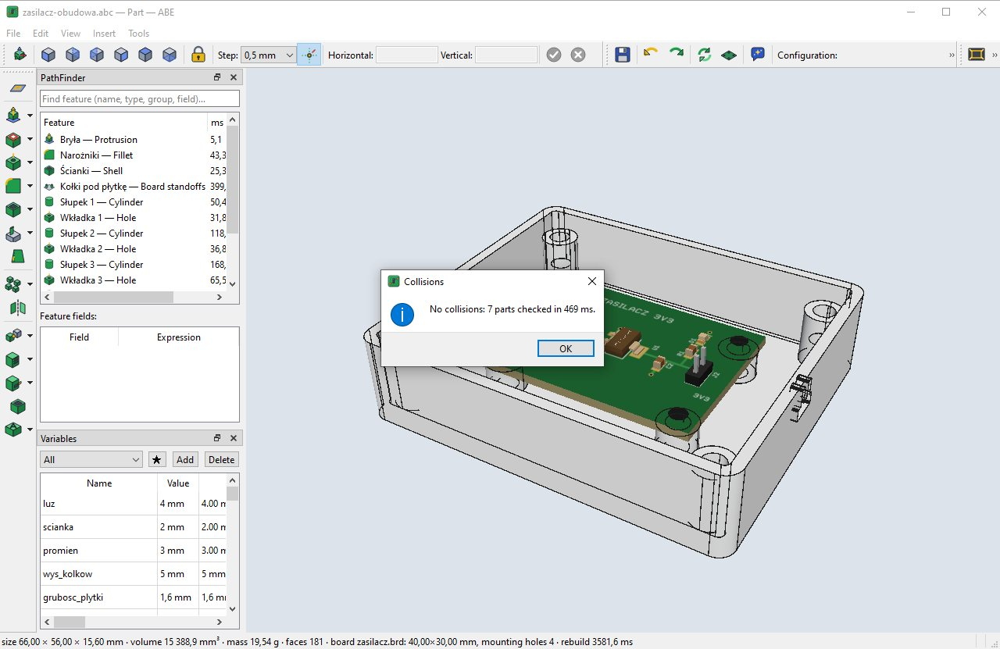

  

  
  
  

<a href="README.md">English</a> · <a href="README.pl.md">Polski</a> · <b>Deutsch</b>

---

**Autodesk hat Eagle am 7. Juni 2026 eingestellt.** Mit ABE arbeitest du an denselben Dateien weiter — ohne Export,
ohne Import und ohne nachzuprüfen, was ein Konverter verloren hat. Projekte und Bibliotheken bleiben in dem Format,
in dem sie entstanden sind.

ABE öffnet `.sch`-, `.brd`- und `.lbr`-Dateien aus Eagle 7.4 direkt und **speichert sie Byte für Byte**: Eine ohne
Änderungen geöffnete und gespeicherte Datei bleibt dieselbe Datei. Neben Schaltplan und Platine hast du im selben
Programm Gehäuse-CAD, 3D, Simulation, Firmware-Programmierung mit Debugger und einen KI-Agenten in den Programmfenstern.

  
   Eine in Eagle 7.4 gespeicherte Platine, geöffnet in ABE Desktop — 3D-Ansicht mit automatisch zugeordneten Bauteilmodellen.

## Warum ABE

| | |
|---|---|
| 📂 **Deine Eagle-Dateien, so wie sie sind** | `.sch` / `.brd` / `.lbr` im XML-Format von Eagle 7.4, gelesen und gespeichert ohne Konvertierung. Auch alte binäre Dateien aus Eagle 4 / 5 lassen sich öffnen. Sicherungskopien wie in Eagle. |
| ⌨️ **Eagle-Gewohnheiten funktionieren** | Eagle-Befehlszeile und `.scr`-Skripte, Schaltplan und Platine bleiben synchron: Werte, Namen, Gehäuse und Gattertausch gelangen in beide Dateien. |
| ✅ **Geprüft, nicht versprochen** | Jede Funktion wird an echten Eagle-Dateien und an der Ausgabe von Eagle selbst geprüft (Gerber, Netzliste, Stückliste) — nicht an passend ausgesuchten Beispielen. |
| 💸 **Kein Abo** | Der Download kostet nichts. Freiwillige Unterstützung über Ko-fi. |

## Was ABE heute kann

**Schaltplan und Bibliotheken** — mehrere Blätter, Netze, Busse, Labels, Versorgungssymbole · Bauteile aus
`.lbr`-Dateien, UPDATE von Bibliotheken · Symbol- und Gehäuse-Editor · Stückliste und Netzliste im EXPORT-Format von Eagle.

**Platine** — Leiterbahnen verlegen, Vias, RIPUP, Gatter- und Pintausch · Kupferflächen berechnet, nicht nur umrissen ·
Netzklassen, differenzielle Paare, Mäander · Autorouter über FreeRouting (Specctra DSN / SES).

**Prüfungen** — ERC des Schaltplans und DRC der Platine · Kupfer-Konnektivität: was wirklich verbunden und was nur
gezeichnet ist · Lötstoppmaske und Umriss im Hinblick auf die Fertigung · Prüfungen guter Praxis, die Eagle nicht durchführt.

**Gerber und Bohrdaten** — komplettes ZIP für den Leiterplattenhersteller: Kupfer, Lötstoppmaske, Lotpaste,
Bestückungsdruck, Umriss, Excellon · Layer verglichen mit der CAM-Ausgabe von Eagle selbst · Vergleich zweier
Gerber-Sätze nach Abdeckung, nicht nach Objektanzahl.

**3D** — Basismaterial, Kupfer mit berechneten Kupferflächen, Lötstoppmaske, Lotpaste, Bestückungsdruck · Schnitt,
Abstandsmessung, mechanische Kollisionen · Export als 3MF und PNG.

<table>
  <tr>
    <td width="50%"> <b>Platinen-Editor</b> — Eagle-Layer und -Farben, Eagle-Befehle.</td>
    <td width="50%"> <b>DRC</b> — Designregeln geprüft, Fehler auf der Platine angezeigt.</td>
  </tr>
</table>

## Mehr als Schaltplan und Platine (ABE Desktop)

- **Gehäuse-CAD** — Volumenmodellierung mit Feature-Historie, von der Skizze bis zur Fertigungszeichnung; Gehäuse aus
  der Platine, Befestigungsdome auf den Montagelöchern, Kollisionen und freie Höhe im Inneren.
- **Baugruppen** — Platine, Gehäuse und Mechanik in einer Baugruppe; eine Änderung an der Platine zeigt sich im Gehäuse.
- **Simulation** — SPICE im Schaltplan, Probleme direkt an Bauteilen und Netzen angezeigt.
- **Firmware** — Arduino, STM32 und MicroPython neben der Platine, mit Debugger und dem Schaltplan zur Hand.
- **Fertigung** — Gerber, Bestückungsdaten (Pick-and-Place), interaktive Stückliste, Bestückungsvarianten, Slicer für den 3D-Druck.
- **KI-Agent** — ein lokales Modell, Claude oder Claude Code im Programmpanel, arbeitet mit ABEs eigenen Befehlen.

<table>
  <tr>
    <td width="50%"> <b>Gehäuse aus der Platine</b> — Wände, Dome und Öffnungen folgen der Leiterplatte.</td>
    <td width="50%"> <b>Platine im Gehäuse</b> — Kollisionen und freie Höhe.</td>
  </tr>
</table>

> Einige dieser Teile sind noch im Aufbau — die Website kennzeichnet jeden davon ehrlich.
> In den [Anleitungen](https://abe.kassp.pl/witaj/poradniki.html) steht Schritt für Schritt, mit Screenshots, was schon funktioniert.

## Download

| System | Datei | Voraussetzungen |
|---|---|---|
| **Windows** | [ABE-Desktop-setup.exe](https://abe.kassp.pl/desktop/ABE-Desktop-setup.exe) | Windows 10 oder neuer, 64 Bit, Grafik mit Direct3D 12 |
| **Linux** | AppImage, `.deb`, `.rpm`, Flatpak — [Erste Schritte](https://abe.kassp.pl/witaj/poradniki.html) | 64 Bit, Grafikkarte und Treiber mit Vulkan 1.2 |
| **Browser** | [ABE Web](https://abe.kassp.pl/) — eine echte Eagle-Platine [ohne Anmeldung](https://abe.kassp.pl/witaj/przyklad.html) | aktueller Browser; Chrome / Edge auch mit einem Projektordner auf deiner Festplatte |

Der Installer ist ein kleines Startprogramm. Es lädt ABE und seine **signierten** Updates herunter und wechselt direkt
beim Start auf eine neue Version.

## Rückmeldungen

- 🐞 **Fehler gefunden?** [Fehler melden](../../issues/new?template=bug.yml) — die ABE-Version und was du gemacht hast, reicht.
- 💡 **Fehlt dir etwas aus Eagle?** [Vorschlagen](../../issues/new?template=idea.yml) — das meiste in ABE ist aus solchen Wünschen entstanden.
- 💬 **Fragen und eigene Projekte zeigen:** [Diskussionen](../../discussions).

Meldungen auf Deutsch sind willkommen. Bitte hänge keine Platinen an, die du nicht öffentlich zeigen darfst —
beschreibe das Problem, und wenn die Datei nötig ist, fragen wir privat danach.

## Unterstützung

ABE wird unabhängig entwickelt. Wenn es dir Zeit spart, kannst du einen virtuellen Kaffee spendieren oder das Projekt
monatlich unterstützen: [Ko-fi](https://ko-fi.com/karolszymanski). Jede Unterstützung fließt direkt in neue Funktionen
und den Serverbetrieb.

---

Dieses Repository ist die öffentliche Heimat von ABE: Releases, Anleitungen und Issues. Der Quellcode des Programms
wird hier nicht veröffentlicht. EAGLE ist eine Marke von Autodesk, Inc. ABE ist kein Produkt von Autodesk und steht in
keiner Verbindung zu Autodesk.
