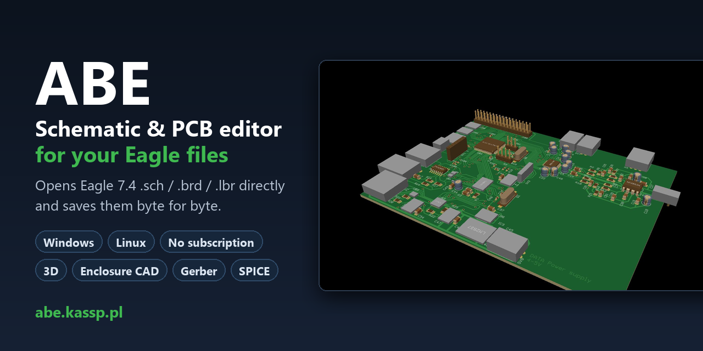
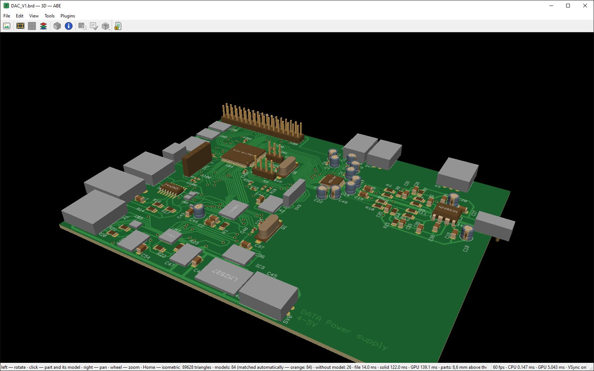
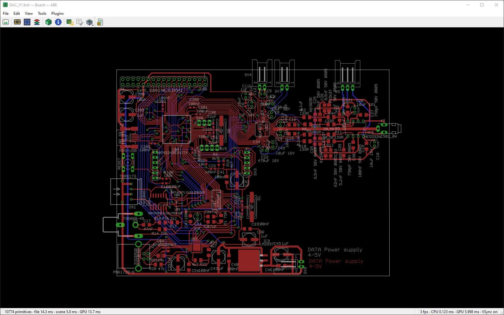
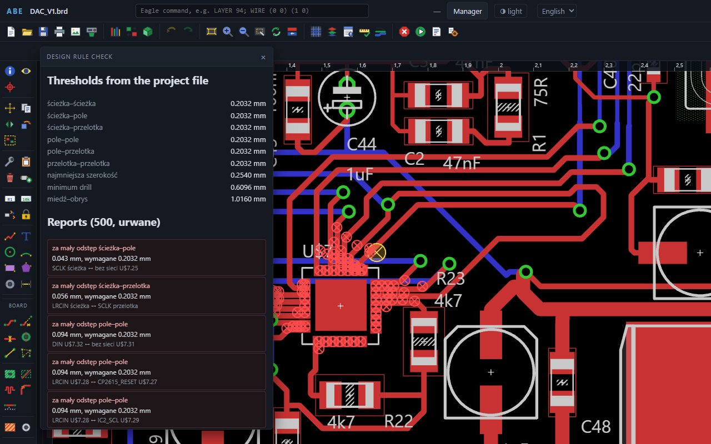
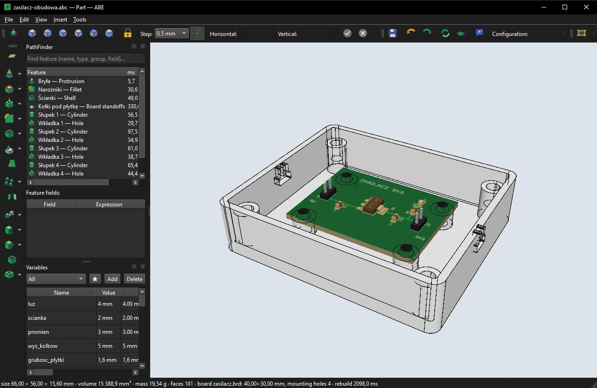
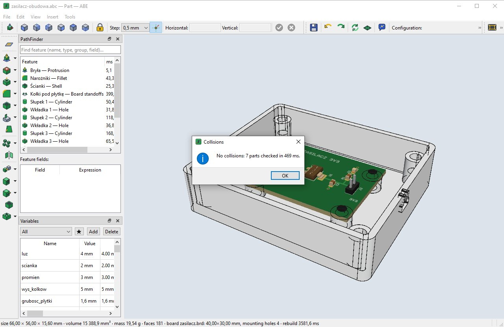

  

  
  
  

  
  
  
  

<b>English</b> · <a href="README.pl.md">Polski</a> · <a href="README.de.md">Deutsch</a>

---

**Autodesk retired Eagle on 7 June 2026.** ABE lets you keep working on the same files — no export, no import,
no checking what a converter lost. Your projects and libraries stay in the format they were made in.

ABE opens Eagle 7.4 `.sch`, `.brd` and `.lbr` files directly and **saves them byte for byte**: a file opened and saved
without changes stays the same file. Next to the schematic and the board you get, in one program, enclosure CAD,
3D, simulation, firmware programming with a debugger, and an AI agent working in the program windows.

  
   A board saved in Eagle 7.4, opened in ABE Desktop — 3D view with automatically matched component models.

## Why ABE

| | |
|---|---|
| 📂 **Your Eagle files, as they are** | `.sch` / `.brd` / `.lbr` in the Eagle 7.4 XML format, read and saved without conversion. Old binary Eagle 4 / 5 files open too. Backup copies like Eagle's. |
| ⌨️ **Eagle habits work** | Eagle command line and `.scr` scripts, schematic–board pair kept in sync: values, names, packages and gate swaps reach both files. |
| ✅ **Checked, not promised** | Every feature is tested against real Eagle files and against the output of Eagle itself (Gerber, netlist, partlist) — not against examples picked to pass. |
| 💸 **No subscription** | Download costs nothing. Optional support on Ko-fi / Patronite. |

## What ABE does today

**Schematic and libraries** — multiple sheets, nets, buses, labels, supply symbols · parts from `.lbr` files, library
UPDATE · symbol and package editor · bill of materials and netlist in Eagle's EXPORT format.

**Board** — routing, vias, RIPUP, gate and pin swap · copper pours computed, not just outlined · net classes,
differential pairs, meanders · autorouting through FreeRouting (Specctra DSN / SES).

**Checks** — schematic ERC and board DRC · copper connectivity: what is really connected and what is only drawn ·
solder mask and outline checked for manufacturing · good-practice checks that Eagle does not do.

**Gerber and drill** — a ZIP set for the fab: copper, mask, paste, silkscreen, outline, Excellon · layers compared with
the CAM output of Eagle itself · comparing two Gerber sets by coverage, not by object count.

**3D** — laminate, copper with computed pours, mask, paste, silkscreen · section plane, distance measurement,
mechanical collisions · export to 3MF and PNG.

<table>
  <tr>
    <td width="50%"> <b>Board editor</b> — Eagle layers and colours, Eagle commands.</td>
    <td width="50%"> <b>DRC</b> — design rules checked, errors shown on the board.</td>
  </tr>
</table>

## Beyond schematic and board (ABE Desktop)

- **Enclosure CAD** — solid modelling with a feature history, from a sketch to a production drawing; an enclosure
  generated from the board, mounting bosses on the board's holes, collisions and free height inside.
- **Assemblies** — board, enclosure and mechanics in one assembly; a change on the board shows up in the enclosure.
- **Simulation** — SPICE on the schematic, problems shown right on the parts and nets.
- **Firmware** — Arduino, STM32 and MicroPython next to the board, with a debugger and the schematic at hand.
- **Manufacturing** — Gerber, pick-and-place, interactive BOM, assembly variants, slicing for 3D printing.
- **AI agent** — a local model, Claude, or Claude Code in the program panel, working through ABE's own commands.

<table>
  <tr>
    <td width="50%"> <b>Enclosure from the board</b> — walls, bosses and openings follow the PCB.</td>
    <td width="50%"> <b>Board in the enclosure</b> — collisions and free height.</td>
  </tr>
</table>

> Some of these parts are still under construction — the website marks each one honestly.
> See the [tutorials](https://abe.kassp.pl/witaj/poradniki.html) for what works step by step, with screenshots.

## Download

| Platform | Get it | Requirements |
|---|---|---|
| **Windows** | [ABE-Desktop-setup.exe](https://abe.kassp.pl/desktop/ABE-Desktop-setup.exe) | Windows 10 or later, 64-bit, Direct3D 12 graphics |
| **Linux** | AppImage, `.deb`, `.rpm`, Flatpak — [First steps](https://abe.kassp.pl/witaj/poradniki.html) | 64-bit, Vulkan 1.2 graphics card and driver |
| **Browser** | [ABE Web](https://abe.kassp.pl/) — view a real Eagle board [without signing in](https://abe.kassp.pl/witaj/przyklad.html) | a modern browser; Chrome / Edge can also work on a project folder on your disk |

The installer is a small launcher. It downloads ABE and its **signed** updates, and moves to a new version right
at start-up.

## Feedback

- 🐞 **Found a bug?** [Open a bug report](../../issues/new?template=bug.yml) — the ABE version and what you did is enough.
- 💡 **Missing something from Eagle?** [Suggest it](../../issues/new?template=idea.yml) — most of ABE was built on requests like that.
- 💬 **Questions and show-and-tell:** [Discussions](../../discussions).

Please don't attach boards you can't share publicly — describe the problem, and we'll ask privately if a file is needed.

## Support

ABE is developed independently. If it saves you time, you can buy a virtual coffee or support the project monthly:
[Ko-fi](https://ko-fi.com/karolszymanski) (worldwide) · [Patronite](https://patronite.pl/ABE) (Poland).
Every contribution goes straight into new features and server costs.

---

This repository is the public home of ABE: releases, tutorials and issues. The program source code is not
published here. EAGLE is a trademark of Autodesk, Inc. ABE is not an Autodesk product and is not affiliated with
Autodesk.
