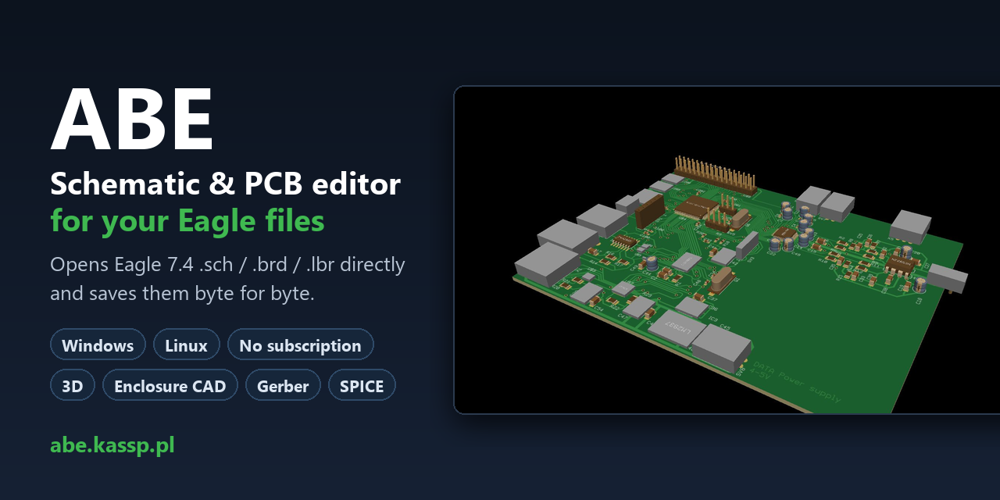
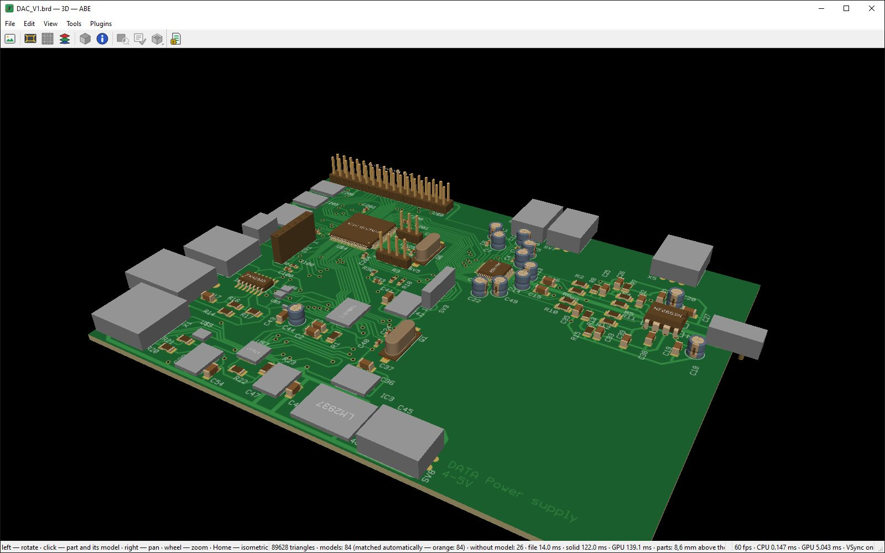
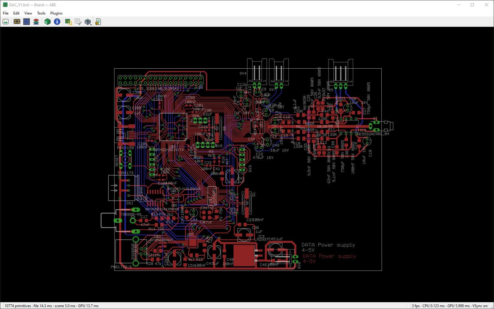
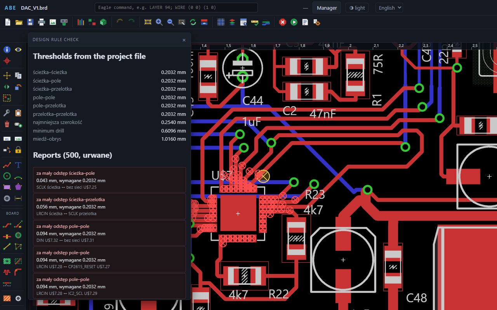
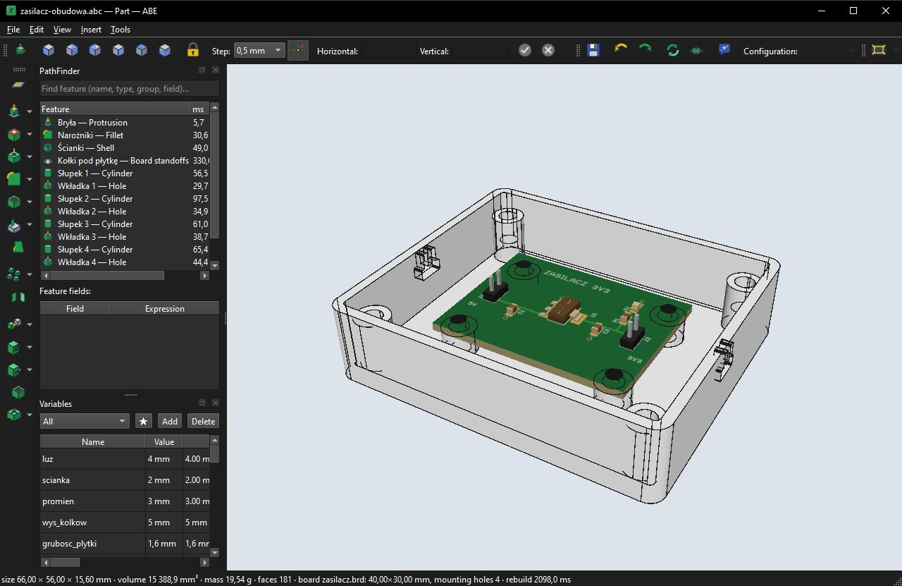
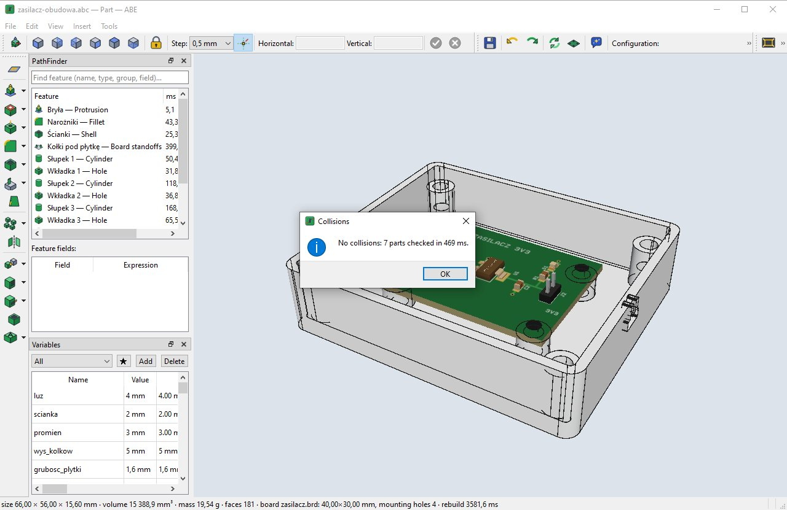

  

  
  
  

<a href="README.md">English</a> · <b>Polski</b> · <a href="README.de.md">Deutsch</a>

---

**Autodesk wycofał Eagle 7 czerwca 2026.** ABE pozwala dalej pracować na tych samych plikach — bez eksportu, bez
importu i bez sprawdzania, co zgubił konwerter. Projekty i biblioteki zostają w formacie, w którym powstały.

ABE otwiera pliki `.sch`, `.brd` i `.lbr` Eagle 7.4 wprost i **zapisuje je bajt w bajt**: plik otwarty i zapisany bez
zmian zostaje tym samym plikiem. Obok schematu i płytki masz w jednym programie CAD obudowy, widok 3D, symulację,
programowanie płytki z debugerem i agenta AI w oknach programu.

  
   Płytka zapisana w Eagle 7.4, otwarta w ABE Desktop — widok 3D z automatycznie dobranymi modelami elementów.

## Dlaczego ABE

| | |
|---|---|
| 📂 **Twoje pliki Eagle, takie jakie są** | `.sch` / `.brd` / `.lbr` w formacie XML Eagle 7.4, czytane i zapisywane bez konwersji. Otwierają się też stare binarne pliki Eagle 4 / 5. Kopie zapasowe jak w Eagle. |
| ⌨️ **Nawyki z Eagle działają** | Wiersz poleceń Eagle i skrypty `.scr`, para schemat–płytka w zgodzie: wartości, nazwy, obudowy i zamiany bramek trafiają do obu plików. |
| ✅ **Sprawdzone, nie obiecane** | Każda funkcja jest sprawdzana na prawdziwych plikach Eagle i na wyjściu samego Eagle (Gerber, netlista, lista części) — nie na przykładach dobranych pod wynik. |
| 💸 **Bez abonamentu** | Pobranie nic nie kosztuje. Wsparcie dobrowolne — Patronite / Ko-fi. |

## Co ABE robi dziś

**Schemat i biblioteki** — wiele arkuszy, sieci, szyny, etykiety, symbole zasilania · części z plików `.lbr`,
UPDATE bibliotek · edytor symbolu i obudowy · zestawienie materiałów i lista połączeń w formacie EXPORT Eagle.

**Płytka** — prowadzenie ścieżek, przelotki, RIPUP, zamiana bramek i nóżek · wylewki policzone, nie tylko obrys ·
klasy sieci, pary różnicowe, meandry · autorouter przez FreeRouting (Specctra DSN / SES).

**Sprawdzenia** — ERC schematu i DRC płytki · spójność miedzi: co jest naprawdę połączone, a co tylko narysowane ·
maska i obrys pod kątem wytwarzania · sprawdzenia dobrej praktyki, których Eagle nie robi.

**Gerber i wiercenie** — komplet do wytwórni w ZIP: miedź, maska, pasta, sitodruk, obrys, Excellon · warstwy
porównywane z wyjściem CAM samego Eagle · porównanie dwóch Gerberów przez pokrycie, nie przez liczbę obiektów.

**3D** — laminat, miedź z policzonymi wylewkami, maska, pasta, sitodruk · przekrój, pomiar odległości, kolizje
mechaniczne · eksport do 3MF i PNG.

<table>
  <tr>
    <td width="50%"> <b>Edytor płytki</b> — warstwy i kolory Eagle, polecenia Eagle.</td>
    <td width="50%"> <b>DRC</b> — reguły sprawdzone, błędy pokazane na płytce.</td>
  </tr>
</table>

## Więcej niż schemat i płytka (ABE Desktop)

- **CAD obudowy** — modelowanie bryłowe z historią operacji, od szkicu do rysunku wykonawczego; obudowa z płytki,
  kołki na otworach montażowych, kolizje i wolna wysokość w środku.
- **Złożenia** — płytka, obudowa i mechanika w jednym złożeniu; zmiana na płytce widać w obudowie.
- **Symulacja** — SPICE na schemacie, problemy pokazane wprost na częściach i sieciach.
- **Oprogramowanie płytki** — Arduino, STM32 i MicroPython obok płytki, z debugerem i schematem pod ręką.
- **Produkcja** — Gerber, pliki do automatu (pick-and-place), interaktywny BOM, warianty montażu, krajalnica do druku 3D.
- **Agent AI** — model lokalny, Claude albo Claude Code w panelu programu, pracujący poleceniami ABE.

<table>
  <tr>
    <td width="50%"> <b>Obudowa z płytki</b> — ścianki, kołki i otwory idą za płytką.</td>
    <td width="50%"> <b>Płytka w obudowie</b> — kolizje i wolna wysokość.</td>
  </tr>
</table>

> Część z tych działów jest jeszcze w budowie — strona uczciwie oznacza każdy.
> W [poradnikach](https://abe.kassp.pl/witaj/poradniki.html) jest krok po kroku, ze zrzutami, to co już działa.

## Pobieranie

| System | Plik | Wymagania |
|---|---|---|
| **Windows** | [ABE-Desktop-setup.exe](https://abe.kassp.pl/desktop/ABE-Desktop-setup.exe) | Windows 10 lub nowszy, 64-bit, grafika Direct3D 12 |
| **Linux** | AppImage, `.deb`, `.rpm`, Flatpak — [Pierwsze kroki](https://abe.kassp.pl/witaj/poradniki.html) | 64-bit, karta i sterownik Vulkan 1.2 |
| **Przeglądarka** | [ABE Web](https://abe.kassp.pl/) — prawdziwa płytka Eagle [bez logowania](https://abe.kassp.pl/witaj/przyklad.html) | współczesna przeglądarka; Chrome / Edge także na katalogu projektu na dysku |

Instalator to mały program startowy. Pobiera ABE i jego **podpisane** aktualizacje, a na nową wersję przechodzi od razu
przy uruchomieniu.

## Uwagi i zgłoszenia

- 🐞 **Błąd?** [Zgłoś błąd](../../issues/new?template=bug.yml) — wystarczy wersja ABE i co zrobiłeś.
- 💡 **Brakuje czegoś z Eagle?** [Zaproponuj](../../issues/new?template=idea.yml) — większość ABE powstała z takich próśb.
- 💬 **Pytania i pochwal się projektem:** [Dyskusje](../../discussions).

Nie załączaj płytek, których nie możesz pokazać publicznie — opisz problem, a o plik poprosimy prywatnie.

## Wsparcie

ABE powstaje niezależnie. Jeśli oszczędza Ci czas, możesz postawić wirtualną kawę albo wspierać projekt co miesiąc:
[Patronite](https://patronite.pl/ABE) · [Ko-fi](https://ko-fi.com/karolszymanski).
Każde wsparcie idzie bezpośrednio na nowe funkcje i utrzymanie serwerów.

---

To repozytorium to publiczny dom ABE: wydania, poradniki i zgłoszenia. Kod źródłowy programu nie jest tu
publikowany. EAGLE jest znakiem towarowym Autodesk, Inc. ABE nie jest produktem Autodesk i nie jest z Autodesk
powiązany.
